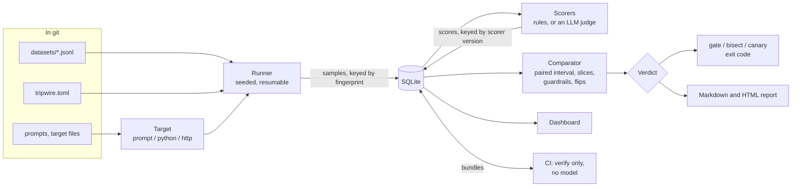

# Architecture

Tripwire is one Python package, one SQLite file and a command line. This page says what
each part owns and how a result is produced. Why each choice was made is in
[decisions.md](decisions.md).

## The flow

In one sentence: a *suite* names a dataset, a target and scorers; the runner turns cases
into *samples*; scorers turn samples into *scores*; the comparator turns two sets of
scores into a *verdict*.

## Identity

Everything is found by what it is, not by when it was made.

| Thing | Identified by |
|---|---|
| Case | A hash of its input and expected answer. Tags are not part of it |
| Dataset version | A hash of the sorted case hashes |
| Target, without a model server | The *static key*: a hash of the prompt text, parameters and watched files |
| Target | The *fingerprint*: the static key plus the model's digest |
| Sample | `(fingerprint, case, repetition)` |
| Score | `(sample, scorer, scorer version, metric)` |

Three features fall out of the sample key and need no code of their own: a second run of
an unchanged target calls no model (cache), an interrupted run generates only what is
missing (resume), and "the baseline" is the fingerprint of the target at a git ref, with
no notion of a last run on main. The static key exists so that CI, which has no model,
can still tell which bundle belongs to which target.

Each sample's seed is derived from its case and repetition. Repetitions are therefore
different draws, and the same cases in the same order from a freshly loaded model give the
same answers again ([investigating.md](investigating.md#what-it-takes-for-a-rerun-to-be-identical)).

## Modules

All in `src/tripwire/`.

| Module | Owns |
|---|---|
| `models.py` | `Case` and its content hash |
| `config.py` | `tripwire.toml` and target files, validated; unknown keys are errors |
| `datasets.py` | Load, save, version, lint, stratified split |
| `providers.py` | Ollama, any OpenAI-compatible API, and a deterministic mock |
| `targets.py` | The three target kinds, the fingerprint, the context-window check |
| `runner.py` | Runs a suite: skips stored samples, retries, time budget, errors kept apart |
| `store.py` | The SQLite schema and its migrations |
| `scorers.py` | Rule-based scorers, their versions, the eval self-check |
| `judge.py` | The LLM judge, probes, calibration against labels and against a rule |
| `stats.py` | Intervals, verdicts, power, A/A, kappa. Pure functions over arrays |
| `compare.py` | A single-run summary, and the paired comparison of two fingerprints |
| `gate.py` | Gate against a git ref, bundles, bisect, canary |
| `generate.py` | Perturbations, model-drafted cases, TraceLens import, review |
| `report.py` | Markdown and self-contained HTML |
| `cli.py` | The commands |
| `dashboard.py` | The Streamlit pages, calling the same functions as the commands |

`stats.py` does no I/O. That is what lets its claims be tested by simulation: coverage of
the interval and the false-alarm rate under no change (`tests/test_stats.py`), and the
two-stage gate's error budget (`tests/test_scale.py`).

## Storage

One SQLite file, `tripwire.db`, in WAL mode, not in git.

| Table | Holds |
|---|---|
| `cases`, `dataset_cases` | Cases seen, and which dataset versions contained them |
| `targets` | For each fingerprint, the full specification that produced it |
| `samples` | Output, status (`ok`, `truncated`, `refusal`), seed, tokens, latency, raw reply |
| `errors` | Requests that produced no answer. Never scored |
| `scores` | One row per sample, scorer, version and metric |
| `runs` | Which suite asked, at which commit, on which runtime |
| `comparisons` | Gate and canary results |
| `human_labels` | Blind labels, for measuring the judge |

A failed request and a wrong answer live in different tables, so the first cannot be
counted as the second. When too many cases have no score, the verdict is `INVALID`.

## What calls a model, and what does not

| Calls a model | Never does |
|---|---|
| `run`, `queue`, `bench`, `doctor` | `score`, `selfcheck`, `usage`, `dashboard` |
| `report`, `compare`, `gate`, `bisect`, `power`, `aa`, `label`, `judge calibrate`: only for samples not stored yet | `gate --verify-only` |
| `canary`: always, by design | every test in `tests/` |
| `judge run`, `judge probe`, `dataset gen` | `dataset lint`, `split`, `perturb`, `review` |

## The gate across two machines

A CI runner has no GPU, so the gate is split.

1. On a machine with the model, `tripwire gate SUITE --base REF --bundle` generates what
   is missing and writes each side's samples to `bundles/<dataset version>/` as a small
   deterministic gzip file named by static key and fingerprint.
2. In CI, `tripwire gate SUITE --verify-only` recomputes both static keys from the files
   in the pull request, loads the matching bundles, re-scores the answers and redoes the
   statistics.

CI trusts that a bundle's samples came from the model it names. It does not trust the
scores or the verdict, which it recomputes, and a bundle made for one prompt cannot stand
in for another, because the key is computed from the prompt in the pull request.

## The benchmark

`experiments/zoo.py` generates the variants, `tripwire queue` runs them, and
`experiments/proof.py` replays the gate on the stored scores. `proof.py` uses the same
interval and verdict functions as the gate, so what it measures is the code that ships
([benchmark.md](benchmark.md)).
